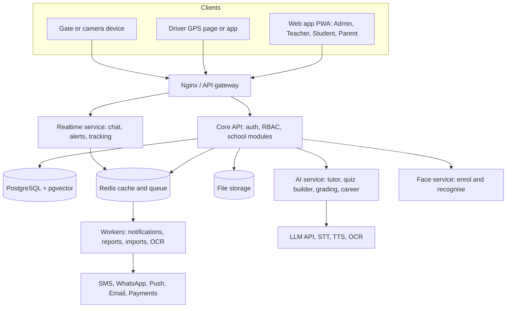

# EduNest: Role Guide and End-to-End Development Blueprint

A smart school portal for Admin, Teacher, Student and Parent, with an AI learning layer. This document has two parts: Part A explains what each role does and how communication flows; Part B explains how to build it end to end (frontend, backend, AI, connectivity, deployment and a phase-wise plan).

## Part A: Product Guide

## 1. Foundation (applies to every role)

Everything hangs off one chain, so no record exists without a school, class and section.

**School → Class → Section → Student** (the parent account is auto-created from the student's parent mobile number)

| Level | Must exist before | Filled in by |
| --- | --- | --- |
| School | Everything else | Super Admin |
| Class (1 to 10) | Sections | School Admin |
| Section (A, B, C) | Students, timetable, attendance | School Admin |
| Class teacher | One per section | School Admin |
| Subject-teacher mapping | Timetable, homework, exams | School Admin |
| Student | Student and parent login | School Admin or bulk Excel import |
| Parent | Parent login | Auto-created from parent mobile |

**Rules to enforce**

- Every student belongs to exactly one school, class and section.
- Every section has one class teacher.
- Every teacher is linked to a school and to the class, section and subject they teach.
- A parent with several children in the same school sees them all under one login.
- Every query is filtered by school, class and section, so one school never sees another school's data.

**Logins**

| Role | Login ID | Password / verification | Data filled in |
| --- | --- | --- | --- |
| Admin | Username or email | Password + OTP or 2FA | School name, code, address, district/mandal, logo, academic year, language, headmaster name and phone, permissions |
| Teacher | Employee ID | Password (forced change on first login) | Name, phone, email, photo, subjects, classes and sections, class-teacher flag, qualification, joining date, face-enrolment photo |
| Student | Admission number | DOB-based first password, then change | Name, age, class, section, roll number, DOB, gender, photo, parent mobile, address, language, category, optional medical notes |
| Parent | Registered mobile | OTP only (works for low-literacy parents) | Name, relation, preferred language, alert channels, linked children, emergency contact |

## 2. Admin: end-to-end list

**One-time setup (per academic year)**

1. Fill in school name, code, address, district/mandal, logo, academic year, default language, headmaster details.
2. Create classes and sections; assign one class teacher per section.
3. Add teachers and map subjects, classes and sections to them.
4. Add students one by one or by bulk Excel import; parent accounts are created automatically.
5. Create the timetable (periods, subjects, teachers, rooms, constraints) or auto-generate it.
6. Set leave types and quotas, and the fee structure per class.
7. Set up face-recognition devices and the confidence threshold.

**Ongoing modules**

| Module | What the admin does |
| --- | --- |
| Home | Dashboard and quick actions |
| News / Announcements | Title, body, attachment, audience (school, class, section), publish date; broadcast with delivery reports |
| Students | Add, edit, promote, transfer, issue TC |
| Attendance | View present/absent by class, section, date range; correct records. Teachers mark it, admin sees how many are present or absent |
| Smart Attendance | Face-enrolment photos, camera setup, confidence threshold |
| ID Scan | Scan QR/barcode at the gate or type the ID |
| Exams | Exam name, dates, classes, rooms, seating; publish results |
| Homework | View completion reports |
| Analytics | Filters by school, class, subject, period; export |
| Knowledge | Approve and manage the library, set syllabus and language |
| Fees | Fee structure, offline payments, concessions, receipts |
| Leave | Approve or reject teacher leave; view student leave that has passed parent and teacher approval; set leave types and quotas |
| Timetable | Create, edit, auto-generate |
| Live | View schedule and attendance reports |
| Transport | Routes, buses, drivers, live tracking |
| Platform | Roles and permissions with audit logs, backup and export, consent management, multi-language configuration, integration keys |

## 3. Teacher: end-to-end list

**Setup:** first login, change password, complete profile (name, phone, email, photo, subjects, classes, qualification, joining date, face-enrolment photo).

| Module | What the teacher does |
| --- | --- |
| Home | Dashboard, personal timetable, duty roster |
| Attendance | Choose class, section, date, period; mark each student present, absent or late |
| Smart Attendance | Open the camera, scan the class, confirm or correct detected faces |
| Timetable | Upload the timetable as an image or text (students see it in their timetable section); request swaps or substitutions |
| Homework | Post class, section, subject, title, description, attachment, due date; review submissions |
| AI Quiz Builder | Upload a quiz PDF; the system extracts questions and builds **MCQ, descriptive, true/false and fill-in-the-blank**; teacher reviews, edits and publishes |
| Exams | Two types: **Mock** (practice) and **Main** (graded). Upload paper and answer key; enter marks manually, by Excel, photo OCR or voice; AI grading of handwritten answers |
| Knowledge | Upload notes, videos, PDFs tagged by class, subject, chapter |
| Live | Schedule and start classes with camera and mic, polls, recording upload |
| Leave (own) | Apply with dates, type, reason; admin approves |
| Leave (students) | Approve or reject student leave for their own section |
| Student care | Behaviour and remarks log, counselling referral, special-needs notes, early-warning flags |
| Communication | Student chat room, parent messages, class news |
| Analytics | Class analytics, learning-gap report, remedial groups, syllabus coverage tracker |
| AI tools | Lesson-plan generator, question-paper and worksheet generator, teaching assistant chatbot |

## 4. Student: end-to-end list

**A. AI learning**

- **Quiz practice:** take teacher-uploaded quizzes (MCQ, descriptive, true/false, fill-in-the-blank). When an answer is wrong, a **robo icon** (chat assistant) appears. The student taps it and picks *Explain answer*, *Why was mine wrong?* or *Next suggestion*. The assistant gives the correct answer, the explanation, and the next suggested practice question.
- **Separate AI Chat** in the nav bar (like ChatGPT): upload sheets and homework and ask questions; photo-based doubt solving; type a topic and get explanation plus **YouTube video links**; previous-year papers and solutions (class, subject, year, including other institutions); speak or type in **Telugu, English or Hindi**.
- **AI Personal Mentor:** explains difficult topics, generates personalised practice, identifies weak subjects, adapts to pace, creates weekly learning plans (for example, easier exercises when maths is weak).
- **Practice tests and mock exams:** subject, chapter and difficulty selection; questions provided by the teacher.
- **Weak-topic detection and revision plans:** derived automatically from test results.
- **AI summaries and mind-maps; spaced-repetition flashcards.**
- **Gamification:** XP, badges, streaks, leaderboards.
- **English tutor and speaking partner:** conversation, interview practice, grammar correction, vocabulary, presentation feedback; improvement tracked privately.
- **Reading and pronunciation coach** (English or Hindi).

**B. Daily school life**

- Personal dashboard; attendance history; section timetable (image or text uploaded by teacher); announcements (read only).
- Homework submission by photo, PDF or voice note.
- Digital ID card with QR; achievements portfolio.
- Leave request (dates, reason, optional attachment) which needs parent permission.
- Online exam portal with auto-grading.
- Report card and progress graph from homework, mock tests and main tests, with topic-wise analysis, knowledge estimation and recommendations.
- Transport and bus tracking.

**C. Growth and community**

- **Career recommendation:** aptitude and interest inputs, AI analyses and guides (doctor, lawyer and so on).
- Scholarship and exam finder, skill courses, anonymous counselling and complaint chat.
- **Peer discussion forum** for doubts, replies and posts.
- **Project space:** a common collaborative area for innovative projects.
- **Teacher-student chat room** with the respective teacher.
- Offline downloads, digital library, text-to-speech, simulations and AR/3D models.
- **UI language switch:** Telugu, English, Hindi.

## 5. Parent: end-to-end list

**Login:** registered mobile plus OTP. Sets preferred language, alert channels and emergency contact. A child selector appears when there are several children.

| Module | What the parent does |
| --- | --- |
| Home | Real-time dashboard for the selected child |
| Attendance | History and instant alerts |
| ID Scan / Smart Attendance | Receives arrival and exit alerts |
| Homework | View done or pending status |
| Exams | Schedule, hall ticket, results |
| Report card | Digital report card, progress trends, AI plain-language report, class comparison |
| Leave | Gives **permission** for the child's leave request |
| Fees | Pay by UPI, card or net banking; download receipt |
| News | Announcements and circulars |
| Chat | Two-way chat with teachers (auto-translated), voice messages |
| Meetings | Book a parent-teacher slot, join video meetings |
| Consent forms | Approve or decline with digital signature |
| Grievance | Submit feedback or complaint and track the ticket |
| Transport | Live bus tracking |
| Support | Guidance articles, homework tips, wellbeing content |
| Safety | **SOS button** and emergency alerts |
| Welfare | Scholarship, mid-day meal and DBT tracking, health records, certificate requests |

## 6. Communication: how it happens

| Flow | Path | Channel |
| --- | --- | --- |
| Announcements | Admin/Teacher to audience (school, class, section) | In-app, push, SMS, WhatsApp; delivery report to sender |
| Teacher and Student | Chat room per teacher or class | In-app chat with text and files |
| Teacher and Parent | Two-way chat, bulk or individual notice | In-app, auto-translated; voice messages |
| Student and Student | Peer forum and project space | In-app threads |
| Student and AI | Robo assistant inside quizzes; AI Chat page | Text, voice, photo; Telugu, English, Hindi |
| Attendance alert | Teacher marks or face scan, then system, then Parent | Instant push, SMS, WhatsApp |
| Gate alert | ID scan, then Parent | Arrival and exit alert |
| Homework | Teacher posts, Student submits, Teacher reviews, Parent sees status | In-app notifications |
| Exam results | Teacher enters marks, Admin publishes, Student and Parent notified | In-app, SMS |
| Student leave | Student form, then **Parent permission**, then **Class teacher** decision, then **Admin** can view | Status at each step |
| Teacher leave | Teacher applies, Admin decides | In-app |
| Fees | Admin sets, Parent notified and pays, receipt to Parent, record to Admin | In-app, SMS |
| Meetings | Parent picks slot, Teacher confirms, video link | In-app |
| Grievance | Submit, ticket, Admin assigns, updates, closed | In-app tracking |
| SOS | Button press, Admin, class teacher and emergency contact alerted | Push, SMS, voice |
| Early warning | System detects risk, Teacher and Admin flagged, counselling referral | In-app |

## 7. End-to-end pipeline across the four roles

**Stage 1, Setup.** Admin creates School, Classes, Sections, assigns class teachers, maps subject teachers, adds teachers, bulk-imports students. Parent accounts are auto-created. Admin publishes timetable, fee structure and leave rules.

**Stage 2, Login.** Admin (email + OTP), Teacher (Employee ID + password), Student (Admission number + password), Parent (mobile + OTP).

**Stage 3, Daily cycle.** Student arrives and is ID or face scanned; attendance is recorded; Parent gets an instant alert; Teacher confirms or corrects; Admin sees live counts. Teacher follows the timetable, runs live classes or uploads notes. Teacher posts homework; Student submits; Teacher reviews; Parent sees status.

**Stage 4, Learning loop.** Teacher uploads a quiz PDF; AI builds the question types; Student attempts; a wrong answer opens the robo assistant for explanation and next suggestion; results feed weak-topic detection; AI builds a revision plan and weekly plan; Student practises with flashcards, AI chat, YouTube links and past papers; Teacher sees the learning-gap report and forms remedial groups.

**Stage 5, Assessment.** Admin schedules mock and main exams; Student takes them; objective questions auto-grade; Teacher grades descriptive answers (manual, OCR or AI); Admin publishes; Student and Parent are notified; report card and progress graph update.

**Stage 6, Requests and approvals.** Student leave: Student, Parent, Class teacher, Admin view. Teacher leave: Teacher, Admin. Fees: Admin sets, Parent pays. Grievance: submit, ticket, Admin resolves.

**Stage 7, Monitoring.** The system aggregates attendance, homework and test data. Student gets dashboard, career recommendation and gamification. Parent gets a real-time dashboard and AI plain-language report. Teacher gets class analytics and early-warning flags. Admin gets school-wide analytics and anomaly detection.

**Stage 8, Continuous communication** runs through every stage: announcements, chats, forum, SOS and transport alerts.

**One line per role.** Admin configures, approves, publishes and monitors. Teacher teaches, marks attendance, builds quizzes and homework, grades and supports. Student learns with AI, submits work, takes tests, requests leave and gets guidance. Parent stays informed, grants permissions, pays fees, talks to teachers and can trigger SOS.

## Part B: Development Blueprint

## 8. Build strategy in one page

Build EduNest as **one web app (responsive, installable as a PWA) plus one backend API plus one AI service**. Do not build separate apps per role. One codebase serves all four roles; the login decides which menu and screens appear (role-based UI). A native Android app can come later by wrapping the same API.

**Principles**

- **Multi-tenant from day one:** every table carries `school_id`; every query is filtered by it.
- **Role-based access (RBAC) in the backend**, not only in the UI.
- **API first:** frontend, mobile app and integrations all use the same REST API.
- **AI as a separate service** so it can be scaled, swapped or paused without touching the school core.
- **Build the core school workflow first** (login, attendance, homework, leave, announcements), then AI, then advanced modules.

## 9. Recommended technology stack

| Layer | Recommended choice | Why |
| --- | --- | --- |
| Frontend | React with Vite or Next.js, TypeScript, Tailwind CSS, shadcn/ui | Fast to build, one codebase for all roles, easy dashboards |
| State and data fetching | TanStack Query, Zustand | Caching, offline-friendly lists |
| Charts | Recharts | Progress graphs, analytics |
| i18n | i18next (Telugu, English, Hindi JSON files) | UI language switch |
| PWA | Workbox service worker | Offline downloads, installable, push |
| Backend API | Python FastAPI (fits your AI and data background) or Node.js NestJS | FastAPI keeps backend and AI in one language |
| Database | PostgreSQL | Relational data, strong constraints, row-level security |
| Cache and queues | Redis plus Celery (or BullMQ) | Background jobs, OTP, rate limits |
| File storage | S3-compatible storage (AWS S3, Cloudflare R2 or MinIO) | PDFs, photos, voice notes, recordings |
| Realtime | WebSockets (FastAPI WebSocket or Socket.IO) | Chat, live alerts, bus tracking |
| Search | PostgreSQL full-text first; Meilisearch later | Library and forum search |
| Vector store | pgvector extension | AI tutor retrieval over textbooks and notes |
| AI / LLM | Claude API (or other LLM API) for tutor, quiz generation, explanations, grading | Multilingual, strong at structured output |
| Speech | Whisper or a cloud STT; cloud TTS (Telugu, Hindi, English) | Voice tutor, pronunciation coach |
| OCR / vision | Vision-capable LLM or Google Vision, Tesseract fallback | Photo doubts, handwritten answers, mark sheets |
| Face recognition | InsightFace / ArcFace model service | Smart attendance |
| Live classes | Jitsi (self-hosted) or LiveKit; Zoom or Meet links as a shortcut | Video classes and meetings |
| Notifications | Firebase Cloud Messaging, SMS gateway (MSG91 or Twilio), WhatsApp Business API | Alerts and OTP |
| Payments | Razorpay or PayU | UPI, card, net banking |
| Maps / tracking | OpenStreetMap or Google Maps, driver app sending GPS | Bus tracking |
| Deployment | Docker, Nginx, GitHub Actions CI/CD, a VPS or AWS/GCP | Simple and repeatable |
| Monitoring | Sentry, Prometheus and Grafana, structured logs | Errors and uptime |

## 10. System architecture

**How a request flows:** browser calls the API with a JWT; the API checks the role and school; reads or writes PostgreSQL; slow work (notifications, PDF extraction, report cards, bulk import) goes to a Redis queue and a worker does it; the result is pushed back by WebSocket or notification.

## 11. Frontend plan

**Structure**

- One React app with four route groups: `/admin`, `/teacher`, `/student`, `/parent`. After login the user is redirected to their group; route guards block other groups.
- Shared components: data table, form builder, file uploader, chat window, notification bell, language switcher, charts, calendar, QR scanner, camera capture, audio recorder.
- Layout: left sidebar (modules from Part A, filtered by role), top bar (school logo, language switch, notifications, profile), mobile bottom navigation for students and parents.
- Floating **robo assistant button** on quiz and homework screens; separate **AI Chat** page in the nav bar.

**Key screens to build**

| Role | Screens |
| --- | --- |
| All | Login (role-aware), first-login password change, profile, notifications, language switch |
| Admin | Setup wizard, class and section manager, teacher and student manager, bulk import, timetable builder, fee setup, leave policy, exams, announcements, analytics, roles and audit logs, transport |
| Teacher | Dashboard, attendance sheet, smart attendance camera, homework creator and review, quiz upload and review, exam and marks entry, content upload, live class room, leave, student remarks, parent chat, analytics |
| Student | Dashboard, quiz player with robo helper, AI Chat, photo doubt, practice and mock tests, flashcards, summaries and mind-maps, timetable, homework submit, leave, report card, career guidance, forum, project space, teacher chat |
| Parent | Child selector, dashboard, attendance, homework status, results, leave permission, fee payment, chat and meetings, consent forms, grievance, bus tracking, SOS |

**Frontend rules:** every text goes through i18n keys (no hard-coded strings); forms validated with Zod; large lists paginated; uploads use pre-signed URLs; show loading, empty and error states on every screen; cache last data for offline viewing.

## 12. Backend plan

**Modules (each is a package with routes, services, models, tests)**

1. **Auth and users:** login for four roles, JWT access and refresh tokens, OTP for parents, 2FA for admin, forced password change, password reset.
2. **School structure:** school, class, section, subject, teacher-subject-section mapping, academic year.
3. **People:** student, teacher, parent, guardian links, bulk import, ID-card and QR generation, promotion and transfer.
4. **Attendance:** manual, face-based, gate scan; late and period-wise records; correction audit.
5. **Timetable:** manual builder, constraint-based auto-generator, uploaded image or text timetable, substitutions.
6. **Homework and submissions:** posting, submission files, grading, status.
7. **Quiz and exams:** question bank, quiz from PDF, mock and main exams, auto-grading, marks entry, results publishing, hall tickets.
8. **Leave:** student workflow (parent, class teacher, admin view) and teacher workflow (admin).
9. **Communication:** announcements, chat rooms, parent chat with auto-translation, forum, project space, meeting booking.
10. **Notifications:** one service that sends push, SMS, WhatsApp and email from templates; per-user channel preferences; delivery reports.
11. **Fees and payments:** structure, invoices, gateway webhook, receipts, concessions.
12. **Knowledge:** content library, tags, approvals, download packs, previous-year papers.
13. **AI gateway:** tutor, explain-wrong-answer, photo doubt, summaries, flashcards, learning plan, career guide, English coach.
14. **Analytics:** weak-topic detection, report cards, progress trends, class comparison, early-warning flags.
15. **Transport:** routes, stops, buses, driver GPS ingestion, live location, ETA.
16. **Platform:** roles and permissions, audit logs, backup, export, consent records, integrations.

**Cross-cutting backend rules**

- Row-level isolation: middleware injects `school_id` from the token into every query; add PostgreSQL row-level security as a second guard.
- Pagination, filtering and sorting on every list endpoint.
- Idempotency keys on payments and bulk imports.
- Soft delete plus audit trail for students, marks and attendance.
- Rate limiting on login, OTP and AI endpoints.

## 13. Database design (core tables)

| Group | Tables |
| --- | --- |
| Tenancy | schools, academic\_years |
| Structure | classes, sections, subjects, class\_subjects, teacher\_assignments |
| People | users (role, login\_id, password\_hash), students, teachers, parents, student\_parents, face\_embeddings |
| Attendance | attendance\_sessions, attendance\_records, gate\_scans |
| Timetable | periods, timetable\_entries, timetable\_uploads, substitutions |
| Homework | homework, homework\_submissions, submission\_files |
| Assessment | question\_bank, quizzes, quiz\_questions, quiz\_attempts, attempt\_answers, exams, exam\_papers, marks, results, report\_cards |
| Leave | leave\_requests, leave\_approvals (step, approver, status, comment), leave\_types, leave\_balances |
| Communication | announcements, announcement\_targets, chat\_rooms, chat\_members, messages, forum\_threads, forum\_posts, projects, project\_members, meetings |
| Notifications | notification\_templates, notifications, delivery\_logs, user\_channel\_prefs |
| Fees | fee\_structures, invoices, payments, receipts, concessions |
| Knowledge | content\_items, content\_tags, downloads, past\_papers |
| AI | ai\_conversations, ai\_messages, topic\_mastery, learning\_plans, flashcards, flashcard\_progress, embeddings |
| Gamification | xp\_events, badges, streaks |
| Care | remarks, counselling\_referrals, early\_warning\_flags, grievances (with SLA timers) |
| Transport | routes, stops, vehicles, driver\_locations |
| Platform | roles, permissions, audit\_logs, consents, backups |

**Important relations:** student belongs to one class and one section; parent links to many students through `student_parents`; leave request has an ordered approval chain (parent, class teacher, admin view); every row has `school_id`, `created_at`, `updated_at`, `created_by`.

## 14. AI services: how each feature is built

| Feature | Approach | Input and output |
| --- | --- | --- |
| Quiz from teacher PDF | Extract text (and page images for scans) then ask the LLM for strict JSON: MCQ, descriptive, true/false, fill-in-the-blank with answer, explanation, topic tag, difficulty. Teacher reviews and publishes. | PDF in; reviewed question set out |
| Robo assistant after a wrong answer | Send question, correct answer, student's answer and topic to the LLM; return explanation plus three buttons: Explain answer, Why was mine wrong, Next suggestion. Next suggestion picks a question on the same weak topic. | Quiz context in; explanation and next question out |
| AI Chat (ChatGPT-style) | Conversation with history, file upload, retrieval over the school's textbooks and notes (pgvector), answers in the student's language and grade level | Text, voice, file, photo |
| Photo doubt | Vision model reads the photo, solves step by step, then offers similar practice questions | Image in; steps out |
| YouTube links for a topic | YouTube Data API search by topic, class and language, filtered to educational channels; store approved links per chapter | Topic in; links out |
| Previous-year papers | Library tagged by class, subject, year and institution; AI solutions generated and cached | Filters in; paper and solution out |
| Weak-topic detection | Track correct rate per topic per student (mastery score); below a threshold marks a weak topic | Automatic |
| Weekly learning plan and adaptive path | Rules plus LLM: pick weak topics, set easier exercises, schedule revision days | Automatic |
| Spaced-repetition flashcards | SM-2 algorithm; LLM only writes the cards | Select lesson |
| Summaries and mind-maps | LLM outputs JSON tree rendered as a mind-map component | Chapter in |
| English tutor and coach | Speech to text, LLM grammar and vocabulary feedback, text to speech, private progress score | Voice in |
| Pronunciation and reading coach | STT transcript compared with the reference text, word-level score | Voice in |
| Career recommendation | Aptitude and interest answers plus marks trend; LLM produces ranked paths with reasons and next steps | Test answers in |
| Handwritten answer grading | OCR or vision plus marking scheme; teacher confirms scores | Photo in |
| Lesson plan, question paper, worksheet | Prompt templates with syllabus unit, Bloom's level and time | Teacher inputs |
| Parent AI progress report | Summarise attendance, homework and test trends in plain Telugu, Hindi or English | Automatic |
| Auto-translation in chat | Translate on send or on view, store original | Message in |

**AI safety and cost rules:** keep AI answers within the student's class syllabus; filter unsafe content; never send student personal data (name, phone) to the model, only pseudonymous IDs and the needed academic text; log every AI call; cache repeated answers; set per-student daily limits; teacher approval before AI-generated quizzes go live.

## 15. Connectivity: what talks to what

| Connection | Method | Notes |
| --- | --- | --- |
| Browser to API | HTTPS REST with JWT | Access token 15 minutes, refresh token 7 days |
| Chat, alerts, live tracking | WebSocket | Rooms per class, teacher or user; Redis pub/sub for scaling |
| API to workers | Redis queue | Retries and dead-letter queue |
| API to AI service | Internal HTTP | AI service has no public access |
| API to LLM, STT, TTS | HTTPS with server-side keys | Keys never in frontend |
| API to SMS and WhatsApp | Provider REST API | Needs approved templates (DLT registration for SMS in India) |
| API to push | Firebase Cloud Messaging | Web push for PWA |
| API to payments | Razorpay order API plus signed webhook | Verify webhook signature, idempotent |
| Face scan device | Camera frame from browser or edge device to the face service | Return matched IDs and confidence |
| Driver GPS | Driver page sends location every 5 to 10 seconds | Parent map subscribes through WebSocket |
| Government and external systems | UDISE+, DIKSHA, Aadhaar/APAAR | Mostly later phase; needs official access, consent and agreements |
| Storage | Pre-signed upload and download URLs | Virus scan on upload, size and type limits |
| Excel import and export | Upload, validate, report row-level errors, commit | Use workers for large files |

## 16. Security, privacy and compliance

- Passwords hashed with Argon2 or bcrypt; OTP expiry and attempt limits; admin 2FA.
- RBAC matrix per role and per module; every sensitive action written to the audit log.
- Data encrypted in transit (TLS) and at rest; separate storage of face embeddings; no raw face images kept after enrolment unless required.
- Consent records for face data, photos and AI usage; parental consent for children's data (India's DPDP Act applies, so confirm requirements with a legal advisor).
- Anonymous counselling must truly hide identity from teachers; only a counsellor role sees escalations.
- Daily database backups, tested restore, and a retention policy.
- Protect against SQL injection, XSS, CSRF, insecure file uploads and broken access control; run a security review before launch.

## 17. Offline and low-bandwidth support

- PWA caches the shell, timetable, announcements and downloaded textbooks, videos and audio.
- Offline-first sync: actions such as attendance marking and homework drafts are queued locally and synced when the connection returns, with conflict rules (server wins for marks, latest wins for drafts).
- Compress images before upload; low-data mode that skips video previews.
- SMS and voice fallback for parents without smartphones.

## 18. Phase-wise plan: how to proceed

Build in phases so something real works early. Durations assume one to three developers; adjust to your team.

| Phase | Weeks | Deliverable | Roles ready |
| --- | --- | --- | --- |
| 0. Foundation | 1 to 2 | Requirements frozen, UI wireframes, database schema, repo, CI, dev and staging servers | None |
| 1. Core platform | 3 to 6 | Login for 4 roles, school structure, student and teacher management, bulk import, RBAC, announcements, notifications (push first), profile | Admin, Teacher, Student, Parent (basic) |
| 2. Daily school life | 7 to 10 | Manual attendance with parent alerts, timetable (manual plus image upload), homework, leave workflow (student, parent, teacher, admin), ID card with QR | All four |
| 3. Assessment | 11 to 14 | Quiz builder from PDF, quiz player, mock and main exams, auto-grading, marks entry, results, report card, progress graph | All four |
| 4. AI learning | 15 to 19 | Robo assistant, AI Chat, photo doubt, YouTube links, weak-topic detection, learning plan, flashcards, summaries, multilingual voice | Student, Teacher |
| 5. Communication | 20 to 22 | Teacher-student chat room, parent chat with translation, forum, project space, meeting booking, grievance tickets | All four |
| 6. Money and campus | 23 to 25 | Fees and payments, transport tracking, SOS, consent forms | Admin, Parent |
| 7. Advanced | 26 to 30 | Smart face attendance, live classes, career recommendation, English coach, early-warning, anomaly detection, analytics dashboards | All four |
| 8. Hardening and launch | 31 to 34 | Load and security testing, backups, bug fixing, training material, pilot in one school, then rollout | All four |

**Advice on order:** if you must show a working demo early, finish Phases 1 to 3 plus the robo assistant and AI Chat from Phase 4. That already covers the core story: login, attendance, homework, leave, quiz and AI help. Treat face recognition, live classes, UDISE+ and AR/3D as later additions.

## 19. Testing and quality

- Unit tests for services and permission rules; API tests for every endpoint; test that one school can never read another school's data.
- End-to-end tests (Playwright) for the main flows: login, mark attendance, post and submit homework, leave approval chain, quiz with wrong answer and robo help, fee payment.
- Load test for peak times (morning attendance, result publishing).
- AI evaluation set: sample questions in Telugu, Hindi and English checked for correctness and syllabus fit.
- Usability testing with real teachers and parents, especially on low-end phones.

## 20. Deployment and operations

- Environments: local, staging, production, each with its own database and keys.
- Docker Compose for early stages; move to managed containers or Kubernetes only when scale demands it.
- CI/CD: run tests, build images, deploy on merge; database migrations with Alembic (FastAPI) or Prisma (Node).
- Observability: Sentry for errors, uptime checks, dashboards for queue length, API latency and AI cost.
- Backups: nightly database snapshot, file storage versioning, quarterly restore drill.

## 21. Team, cost and risks

**Minimum team:** one full-stack lead, one frontend developer, one backend or AI developer, part-time designer and tester. A solo build is possible for a pilot if you follow the phase order and keep Phase 7 out of scope.

**Main cost drivers:** LLM and speech usage, SMS and WhatsApp messages, video infrastructure, cloud hosting and storage.

| Risk | Mitigation |
| --- | --- |
| AI gives wrong answers | Teacher review for generated quizzes, syllabus-grounded retrieval, thumbs-down feedback, evaluation set |
| Telugu voice quality | Test STT and TTS vendors early; keep text fallback |
| Face recognition accuracy and privacy | Make it optional, consent first, confidence threshold, teacher confirms |
| SMS and WhatsApp approvals take time | Start DLT and WhatsApp template registration in Phase 1 |
| Scope too large | Follow the phases; ship Phases 1 to 3 first |
| Poor connectivity in schools | PWA offline mode, SMS fallback |
| Data leak between schools | Tenant filter in code plus row-level security plus tests |

## 22. Immediate next steps

1. Confirm the stack (suggested: React + FastAPI + PostgreSQL + Redis + S3 + LLM API).
2. Freeze the Phase 1 and 2 screen list and design wireframes.
3. Create the repository, Docker setup, CI and the database schema for tenancy, structure and people.
4. Build login for the four roles and the RBAC middleware first; every later module depends on it.
5. Start SMS and WhatsApp template registration and payment gateway KYC in parallel, since approvals take weeks.
6. Build Phase 2 end to end with real data from one pilot class, then move on to the quiz and AI features.
